# 1. Distribution Station System

## Description

The Distribution Station is a modular industrial automation subsystem within a larger production system, designed to store workpieces and supply them individually to subsequent production processes. The system is implemented as a simulated plant environment in EcoStruxure Automation Expert (EAE) and is controlled by a distributed control application.

## Physical Architecture & Mechatronic Units

The station consists of two primary mechatronic subsystems that must coordinate their physical actions to execute the workpiece-handling process:

* **Stack Magazine:** Stores available workpieces and dispenses them one at a time into the pickup zone. Its controller monitors magazine sensors and drives the dispensing actuator to release workpieces when downstream conditions permit.

* **Transfer Unit:** Collects the dispensed workpiece from the Stack Magazine and transports it to the designated output position. Its controller coordinates the transfer and workpiece-handling actuators based on positional and status sensor feedback.

## Control & Implementation Environment

The system operates within the EcoStruxure Automation Expert (EAE) base solution, which provides:

* **Plant Simulation Model:** Represents the physical dynamics, constraints, sensors, and actuators of the station. The controller is strictly constrained to the sensor feedback and actuator commands exposed by this simulation.

* **Human-Machine Interface (HMI):** Provides operator panels for manual equipment actuation, mode selection, system-level commands, and status indicators.

* **Distributed IEC 61499 Application:** The control software layer responsible for state management, interlock enforcement, and inter-unit coordination across distributed components using the IMC (Interface-Mechatronic-Coordination) design pattern.

## Operating Modes

The system supports two mutually coordinated operating modes with controlled transitions that account for the real-time physical state of the equipment:

* **Automatic Mode:** The controller autonomously coordinates the Stack Magazine and Transfer Unit to continuously dispense and transfer workpieces without operator intervention. Production cycles repeat until all workpieces are exhausted or operation is halted by the operator.

* **Manual Mode:** Allows the operator to trigger individual equipment functions directly via the HMI. The controller enforces safety and state interlocks so manual actions cannot conflict with automatic sequences.

## System States/Flag & Operator Commands

* **Init & Ready:** Establishes a known, safe home condition prior to production. The system only signals Ready when both physical equipment positions and internal controller states satisfy start conditions.

* **Start:** Initiates the continuous Automatic production cycle once the system is in the Ready state.

* **Stop:** Terminates active Automatic operation and brings both the physical equipment and controller logic to a defined, stable state.

* **Reset:** Drives both the internal controller logic and the physical actuators back to their defined initial home conditions, verifying physical position via sensors rather than merely resetting software states.

* **Ack:** Tracks workpiece availability. The Ack indicator remains steadily illuminated while workpieces are present and flashes once the magazine is empty and processing is complete. Pressing Ack while flashing acknowledges completion of the batch.

## System overlook

### Visualization:

  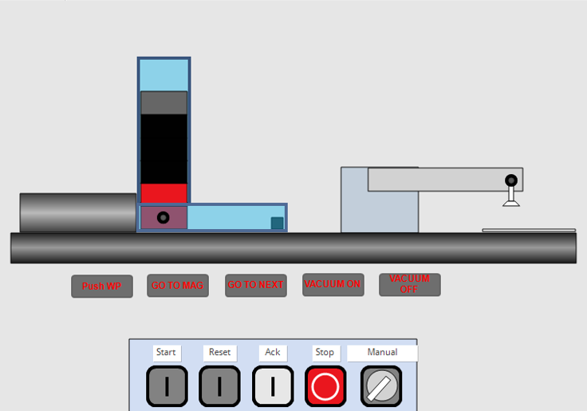 
  <i>Figure 1. System. In the picture above we can see whole system – pusher, transfer unit, sensors and manual and automatic operating mode buttons.</i>

### Pusher positions:

  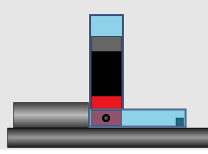 
  <i>Figure 2. Pusher in retracted position</i>

  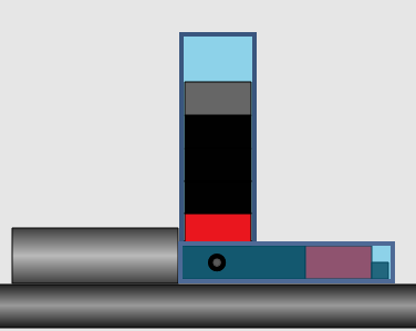 
  <i>Figure 3. Pusher in extended position</i>

### Transfer unit positions:

  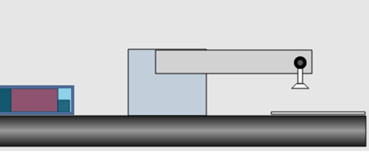 
  <i>Figure 4. Transfer unit at Put/at_nxt/NXT position</i>

  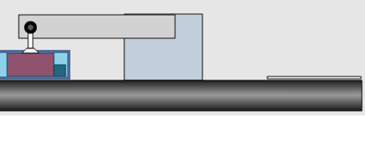 
  <i>Figure 5. Transfer unit at Put/at_mgz/MGZ position</i>

### Vacuum gripper states:

  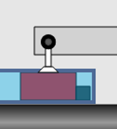 
  <i>Figure 6. Object released</i>

  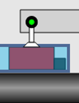 
  <i>Figure 7. Object gripped</i>

# 2. System Requirements

## 2.1 Initial requirements

* **RI-01** | WHEN system initialisation is triggered, the Controller shall command the Stack Magazine and Transfer Unit actuators to move to its home position.

* **RI-02** | WHEN system initialisation is completed and the Stack Magazine is not empty, the Controller shall command the Acknowledge (Ack) indicator to illuminate continuously.

## 2.2 System state and operating behaviour requirements

* **RST-01** | WHEN all station actuators are verified by feedback sensors to be in their home positions, the Controller shall transition to the Initial state.

* **RST-02** | WHEN the system is in Automatic mode, all actuators are confirmed in their Initial state, and the Start command is received, the Controller shall initiate automatic production.

* **RST-03** | WHEN the Stop command is received during active automatic production, the Controller shall halt automatic operation and bring all actuators to a defined, sensor-verifiable safe/stable position.

* **RST-04** | IF the Reset command is received while automatic operation is stopped, the Controller shall command all actuators to return to their home positions (Initial state).

* **RST-05** | IF the Start command is received while automatic operation is stopped, the Controller shall resume automatic production.

## 2.3 Manual operation requirements

* **RM-01** | WHEN Manual mode is active and a valid manual control command is actuated, the Controller shall execute the corresponding equipment movement.

## 2.4 Automatic operation requirements

* **RA-01** | WHEN automatic production is initialized and both the Stack Magazine and Transfer Unit are confirmed in their Initial states, the Controller shall simultaneously command the magazine pusher to extend and the Transfer Unit to move to the workpiece pick-up position.

* **RA-02** | IF the magazine pusher is fully extended, the Controller shall command it to return to retracted position.

* **RA-03** | IF the Transfer Unit has reached the pick-up position, the Controller shall activate the vacuum gripper to grip the workpiece.

* **RA-04** | WHEN the vacuum sensor confirms the workpiece is gripped, the Controller shall command the the Transfer Unit to move to the drop-off position.

* **RA-05** | WHEN the Transfer Unit has reached the drop-off position and the vacuum sensor confirms the workpiece is held, the Controller shall deactivate the vacuum gripper to release the workpiece and command all actuators to return to their Initial state.

## 2.5 Safety and interlocking requirements

* **RSA-01** | The Controller shall enter Automatic mode only WHEN the physical mode selector is set to Automatic and all station actuators are confirmed in their Initial state.

* **RSA-02** | The Controller shall enter Manual mode only WHEN the physical mode selector is set to Manual and all station actuators are confirmed in their Initial state.

* **RSA-03** | The Controller shall inhibit operating mode changes while an active production cycle is in progress or when the actuators are not in their Initial state (disregarding mode selection inputs until the station is in its default state).

## 2.6 General requirements

* **RG-01** | WHEN the system is in Automatic mode and all actuators are confirmed in their home positions, the Controller shall illuminate the Start indicator (signalling Ready).

* **RG-02** | WHEN automatic production is actively executing, the Controller shall turn off both the Start and Reset indicators.

* **RG-03** | WHEN automatic operation has been stopped, the Controller shall illuminate both the Start and Reset indicators.

* **RG-04** | WHEN the Stack Magazine sensor detects that no workpieces remain, the Controller shall command the Acknowledge (Ack) indicator to flash at a defined interval.

* **RG-05** | WHEN the Acknowledge (Ack) indicator is flashing and the Ack button is pressed, the Controller shall turn off the Acknowledge indicator.

# 3. Controller design

## Before refactoring

  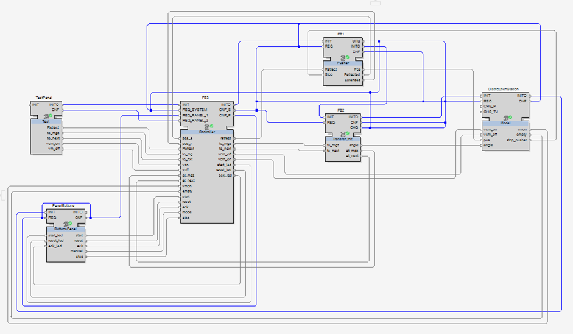 
  <i>Figure 8. Whole system</i>

  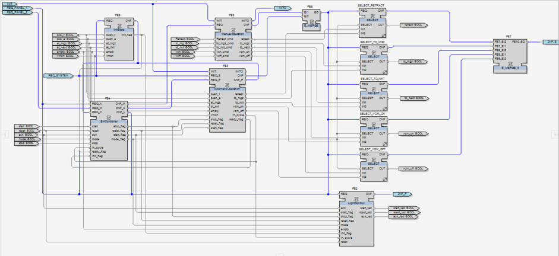 
  <i>Figure 9. Insides of Controller block</i>

  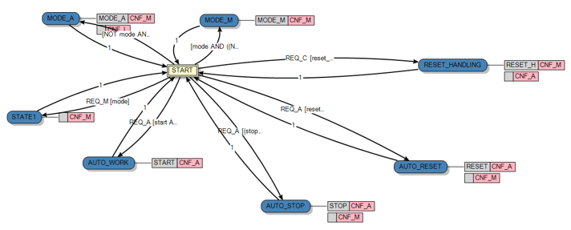 
  <i>Figure 10. BtnController ECC</i>

## After refactoring

  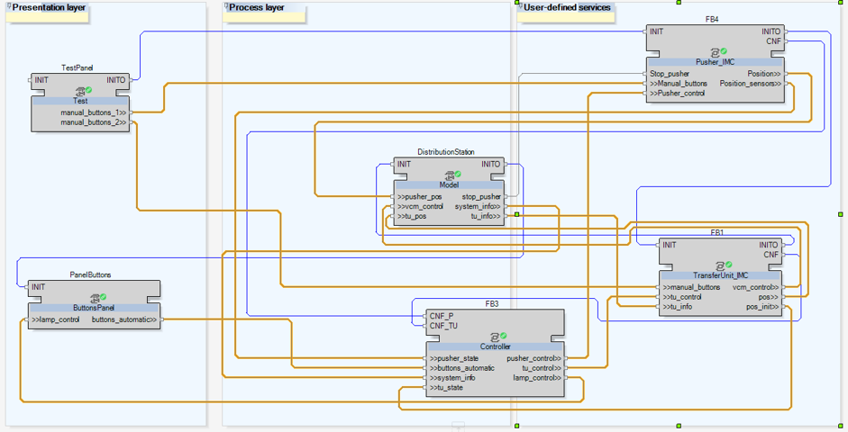 
  <i>Figure 11. System</i>

  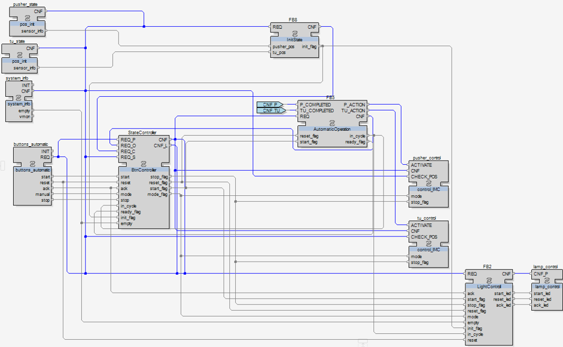 
  <i>Figure 12. Insides of controller block</i>

While the overall system behaviour remains unchanged after refactoring, the underlying software architecture is significantly different. The design transitioned from a single, centralized controller handling all raw I/O to a distributed architecture where individual IMC modules manage the local control cycles for each mechatronic unit. The main controller now operates at a supervisory level, issuing high-level command events to the IMCs and waiting for status confirmations before proceeding to the next step in the sequence. Furthermore, the inputs and outputs of most function blocks were encapsulated using Adapter interfaces (Plugs and Sockets) to improve modularity.

  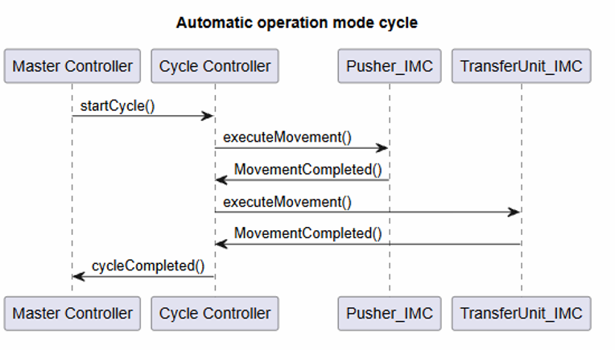 
  <i>Figure 13. Automatic operation cycle controller</i>

  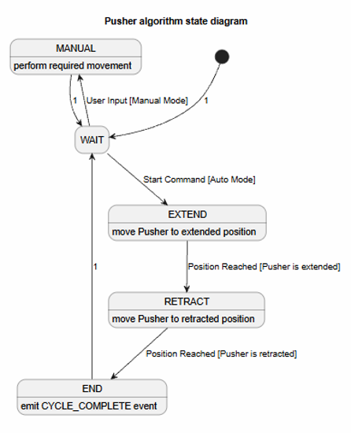 
  <i>Figure 14. Pusher operation algorithm state machine</i>

  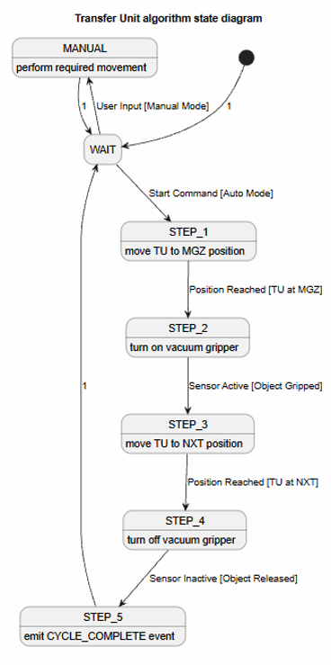 
  <i>Figure 15. Transfer unit operation algorithm state machine</i>

  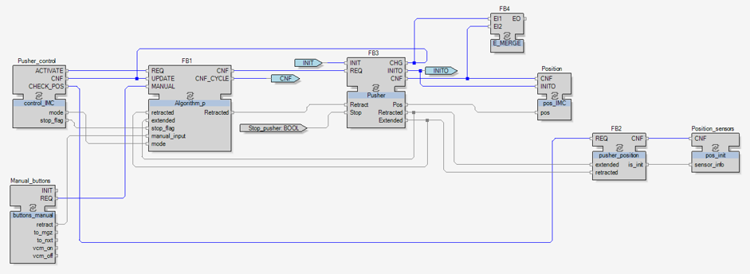 
  <i>Figure 16. Pusher IMC</i>

  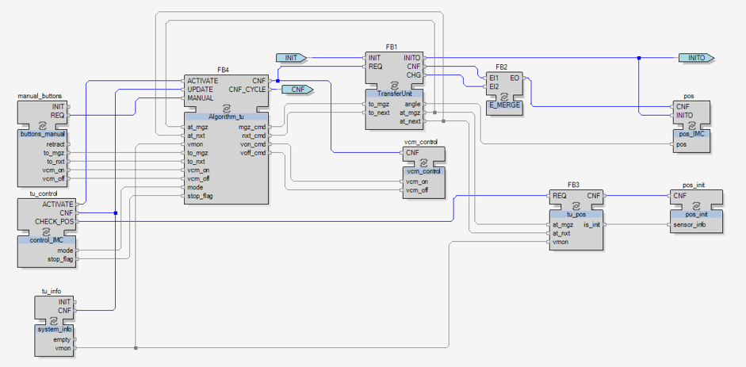 
  <i>Figure 17. Transfer unit IMC</i>

# 4. Requirement Coverage Table

| Requirement | Logical Design | How the Requirement is Addressed | Final Implementation | 
| ----- | ----- | ----- | ----- | 
| **RI-01** | Initialisation state design | Commands Stack Magazine and Transfer Unit to their home positions during system startup. | INIT signal from the device passed on all function blocks during startup. | 
| **RI-02** | System Initialisation behaviour | Illuminates the Ack indicator continuously when initialization is complete and the empty sensor is false. | AckLedControl FB receiving status from model. | 
| **RST-01** | System Initialisation behaviour | Signalling Initial state when feedback confirms all actuators are home. | Control CFB -> InitState FB evaluating ready signals from IMCs. | 
| **RST-02** | Automatic transfer sequence | Initiates the automatic sequence when Start is pressed, mode is Auto, and system is Initialized. | Control CFB -> BtnController (StateController) ECC receiving signals from buttons. | 
| **RST-03** | Stop behaviour design | Halts production and sends safe position commands to IMCs when Stop is received. | Control CFB -> BtnController (StateController) ECC sending stop_flag to IMCs. | 
| **RST-04** | Reset behaviour design | Commands all IMCs to return to home positions when Reset is pressed while system is in stopped state. | Control CFB -> BtnController (StateController) FB ECC sending reset_flag to AutomaticOperation cycle controller. | 
| **RST-05** | Re-start behaviour design | Resumes the automatic cycle if Start is pressed while system is stopped. | Control CFB -> BtnController (StateController) FB ECC. | 
| **RM-01** | Manual operation design | Routes manual inputs directly to actuators via internal SELECT blocks when Manual mode is active. | Local select logic within StackMagazine_IMC and TransferUnit_IMC using Adapter inputs. | 
| **RA-01** | Automatic transfer sequence | Simultaneously commands to Stack Magazine and Transfer Unit to start their own respective operation cycles. | AutomaticOperation sending P_ACTION and TU_ACTION commands to IMCs. | 
| **RA-02** | Pusher movement controller | Retracts pusher when it has received extended position. | Pusher_IMC CFB -> Algorithm_p internal movement control ECC managing local sequence. | 
| **RA-03** | Gripper controller inside transfer unit | Commands Transfer Unit to turn on vacuum gripper if pick-up position has been achieved. | TransferUnit_IMC CFB -> Algorithm_tu internal movement control ECC managing gripper. | 
| **RA-04** | Transfer Unit state diagram | Commands Transfer Unit to go to the put-down position. | TransferUnit_IMC CFB -> Algorithm_p internal movement control ECC managing local sequence. | 
| **RA-05** | Gripper controller inside transfer unit | Commands Transfer Unit to turn off vacuum gripper if pick-up position has been achieved. | TransferUnit_IMC CFB -> Algorithm_tu internal movement control ECC managing gripper. | 
| **RSA-01** | Operating-Mode Transitions | Allows Auto mode entry only if physical selector is Auto and actuators are home. | BtnController (StateController) ECC checking InitState ready_flag. | 
| **RSA-02** | Operating-Mode Transitions | Allows Manual mode entry only if physical selector is Manual and actuators are home. | BtnController (StateController) ECC checking operation flags, button position and ready_flag. | 
| **RSA-03** | Operating-Mode Transitions | Inhibits mode transitions during an active production cycle or when not in default state. | BtnController (StateController) ECC checking operation flags, button position and ready_flag. | 
| **RG-01** | System Ready indication | Illuminates Start LED when in Auto mode and actuators are home. | LightControl CFB, StartLedControl FB logic. Monitoring operation flags. | 
| **RG-02** | System state indicators | Turns off Start and Reset LEDs during active automatic production. | LightControl CFB, StartLedControl, ResetLedControl logic. Monitoring operation flags. | 
| **RG-03** |