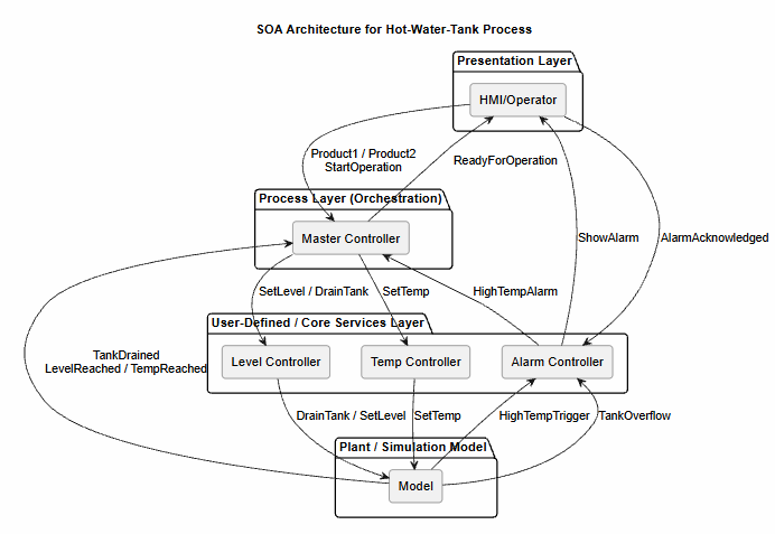
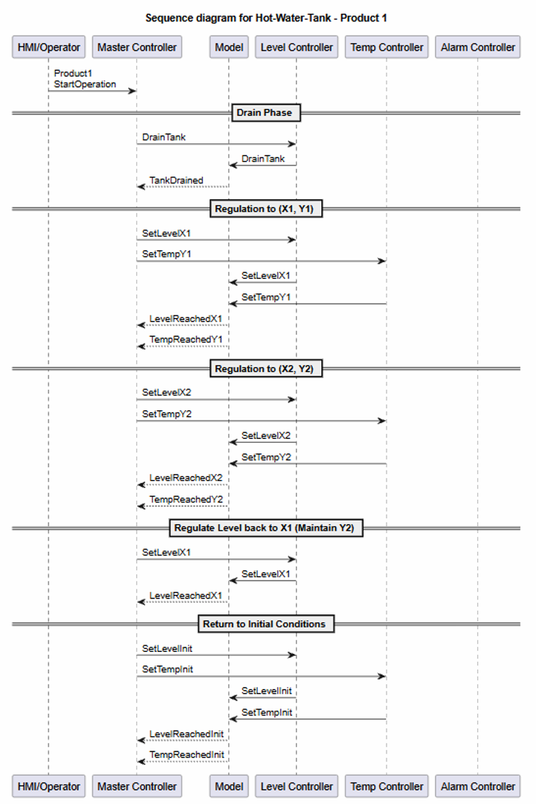
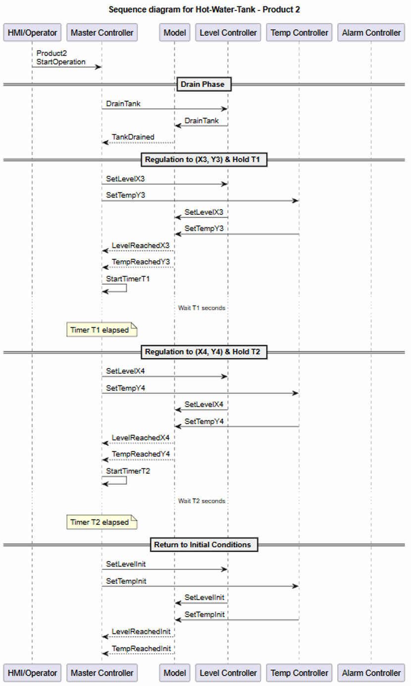

# Continuous Hot-Water-Tank Process Controller

This repository contains the requirements, architecture, and design coverage for the Continuous Hot-Water-Tank process controller.

## Diagrams

Below are the architectural and sequence diagrams illustrating the system's operation:

### Service Oriented Architecture

### Sequence Diagrams

## 1. Requirements

### A. Process Operation
* **RA-01** | **WHEN** there is a command to start preparation of a chosen recipe and both water level and temperature have values specified in initial conditions, the Controller shall start preparing chosen recipe. 
* **RA-02** | **WHEN** After the recipe is completed, the Controller shall return water level and temperature to initial conditions (only in case of recipe 2).
* **RA-03** | **IF** there are two product chosen when start process command is issued, the Controller shall maintain process initial conditions.
* **RA-04** | **WHEN** one of the products is being prepared and command for preparing another is issued, the Controller shall ignore the second command.
* **RA-05** | **WHEN** the certain process is started, the Controller should set values of water temperature or/and water level according to the given recipe for the first stage of process.
* **RA-06** | **WHEN** the actual stage of process is completed, the Controller should set values of water temperature or/and water level according to the given recipe for the next stage of process.
* **RA-07** | **WHEN** the current recipe is completed, the Controller should allow the next process or manual control to operate.

### B. Controller Initialization
* **RB-01** | **WHEN** the controller is initialised, the Controller shall drain the tank before operation can begin.
* **RB-02** | **WHEN** the controller is initialised, the Controller shall set initial water level to 280 cm and initial temperature to 44 degrees. *(Note: values corrected for logical consistency)*

## 2. Process Alarms (Requirement for Alarms)

### C. Alarms

**Alarm 1: Tank overflow**
* **RC-01** | **WHEN** the measured water level is over 400 cm, the Controller shall immediately activate the alarm and inform the operator of the situation that has arisen. The operator shall manually drain the tank and restart the controller.

**Alarm 2: Over-Temperature**
* **RC-02** | **WHEN** the measured water temperature exceeds the absolute safety limit (in this case, when the maxTemp sensor is active), the controller shall immediately activate the alarm and command controller to turn off heating and drain the tank.

## 3. Service Oriented Design

*(See SOA diagram in the Diagrams section)*

## 4. Requirement Coverage Table

**Used abbreviations:**
* **MC** – Master Controller
* **M** – Model
* **LC** – Level Controller
* **TC** – Temperature Controller
* **AC** – Alarm Controller

| Requirement ID | Design Element | Requirement Description | Design Artifact |
| :--- | :--- | :--- | :--- |
| **RA-01** | HMI/Operator, Master Controller | WHEN there is a command to start the recipe and both water level and temperature have values specified in initial conditions, the Controller shall start preparing chosen recipe. | SOA Architecture: HMI ➔ MC Sequence Diag: Product1 / Product2 ➔ StartOperation |
| **RA-02** | Master Controller, Level Controller, Temp Controller | IF the recipe is completed, the Controller shall return water level and temperature to initial conditions. | Sequence Diag (Return Phase): SetLevelInit, SetTempInit, LevelReachedInit, TempReachedInit |
| **RA-03** | Master Controller | IF there are two product chosen when start process command is issued, the Controller shall maintain process initial conditions. | Master Controller - Interlock Logic |
| **RA-04** | Master Controller | WHEN one of the products is being prepared and command for preparing another is issued, the Controller shall ignore the second command. | Master Controller – Internal logic |
| **RA-05** | Master Controller, Level Controller, Temp Controller | WHEN the certain process is started, the Controller should set values of water temperature or/and water level according to the given recipe for the first stage of process. | Sequence Diag: SetLevelX1 / SetTempY1 (P1) or SetLevelX3 / SetTempY3 (P2) |
| **RA-06** | Master Controller, Level Controller, Temp Controller | WHEN the actual stage of process is completed, the Controller should set values of water temperature or/and water level according to the given recipe for the next stage of process. | Sequence Diag: LevelReached / TempReached confirmations ➔ next transition (SetLevelX2 / SetTempY2 or T1/T2 timers) |
| **RA-07** | Master Controller, Alarm Controller, HMI Panel | WHEN the current recipe is completed, the Controller should allow the next process or manual control to operate. | Sequence Diag: RecipeCompleteAlarm, ShowAlarm, AlarmAcknowledged, ReadyForOperation |
| **RB-01** | Master Controller, Level Controller | WHEN the controller is initialised, the Controller shall drain the tank before operation can begin. | SOA Architecture: MC ➔ LC Sequence Diag: DrainTank, TankDrained |
| **RB-02** | Master Controller, Level Controller, Temp Controller | WHEN the controller is initialised, the Controller shall set initial temperature to PLACEHOLDER and initial water level to PLACEHOLDER. *(See RB-02 definition above for actual values)* | SOA Architecture: MC ➔ LC / TC Sequence Diag: SetLevelInit, SetTempInit, LevelReachedInit, TempReachedInit |
| **RC-01** | Master Controller, Alarm Controller, HMI Panel | WHEN a tank is overflowing, the Controller shall display an unacknowledged alarm. | SOA Architecture: AC ➔ HMI |
| **RC-02** | Master Controller, Alarm Controller, HMI Panel | WHEN temperature exceeds the safety threshold, the Controller shall immediately disable heating, and drain tank. | SOA Architecture: M ➔ AC (HighTempTrigger), AC ➔ MC |